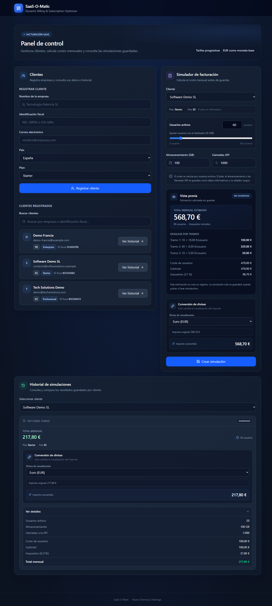

# SaaS-O-Matic

_Dynamic Billing & Subscription Optimizer_

Aplicación full-stack para gestionar clientes empresariales y simular su facturación mensual. Se desarrolló como prueba técnica para el proceso Full-Stack AI-Augmented de Roams.



## Funcionalidad

- Registro, búsqueda y consulta de clientes.
- Simulaciones con precios progresivos por usuarios: 10 € para los primeros 10, 8 € del 11 al 50 y 5 € a partir del 51.
- Impuestos simplificados según país. Los planes, el almacenamiento y las llamadas a la API son informativos y no añaden costes.
- Vista previa de facturación que no guarda datos hasta confirmar la simulación.
- Historial paginado por cliente y visualización de importes en las divisas disponibles.

## Tecnologías

- **Frontend:** React, TypeScript, Vite y Tailwind CSS.
- **Backend:** Node.js, Express, TypeScript, Zod y Prisma.
- **Persistencia:** SQLite.
- **Calidad:** Vitest, React Testing Library y Supertest.

## Requisitos

Node.js, npm y Git. El backend y el frontend se ejecutan en terminales separadas.

## Instalación y ejecución local

1. Clona el repositorio y accede a su carpeta:

   ```bash
   git clone https://github.com/quecoblanco-git/saas-o-matic.git
   cd saas-o-matic
   ```

2. Instala y prepara el backend:

   ```bash
   cd backend
   npm install
   ```

   Crea `backend/.env` con la URL de SQLite:

   ```env
   DATABASE_URL="file:./dev.db"
   ```

   Aplica las migraciones y genera el cliente de Prisma:

   ```bash
   npx prisma migrate deploy --config prisma7.config.ts
   npx prisma generate --config prisma7.config.ts
   ```

   Inicia la API:

   ```bash
   npm run dev
   ```

   La API escucha en `http://localhost:3001`.

3. En otra terminal, instala e inicia el frontend:

   ```bash
   cd frontend
   npm install
   npm run dev
   ```

   Abre `http://localhost:5173`. Vite reenvía las solicitudes `/api` a la API local.

## Comprobaciones

Desde `backend/`:

```bash
npm test
npm run typecheck
npm run build
```

Desde `frontend/`:

```bash
npx vitest run
npm run lint
npm run build
```

## Documentación

- [Requisitos funcionales y técnicos](docs/requirements.md)
- [Arquitectura y modelo de datos](docs/architecture.md)
- [Planificación y decisiones del desarrollo asistido por IA](ai-workspace/README.md)

El repositorio está preparado para desarrollo local. No incluye configuración de despliegue en producción.
