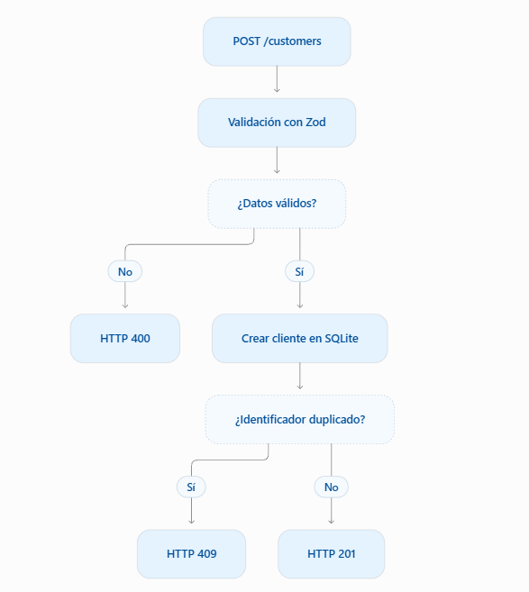
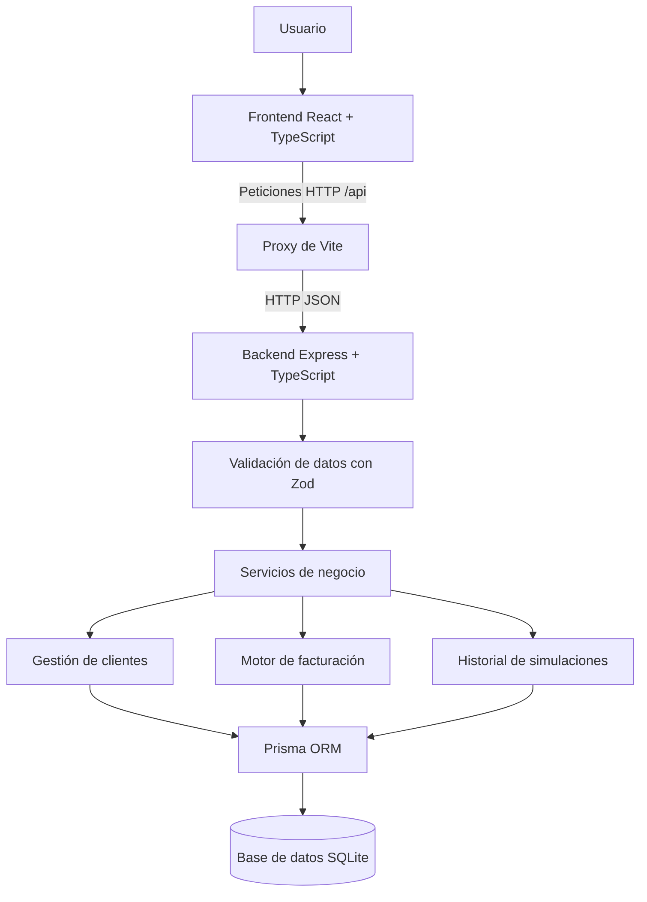
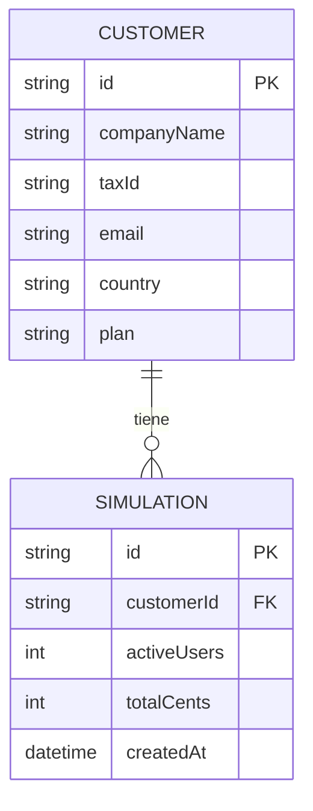
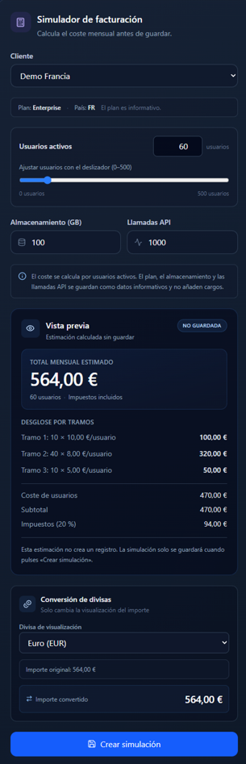
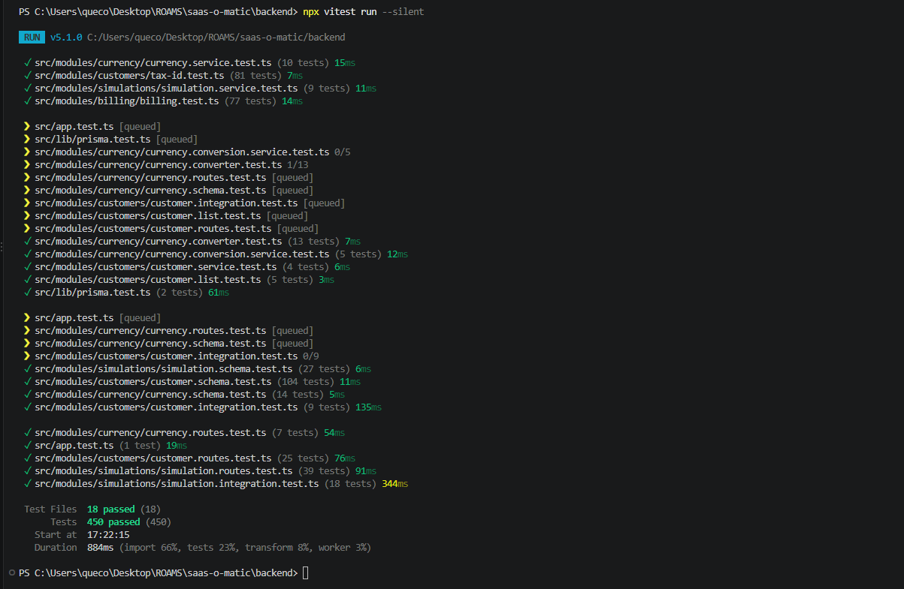
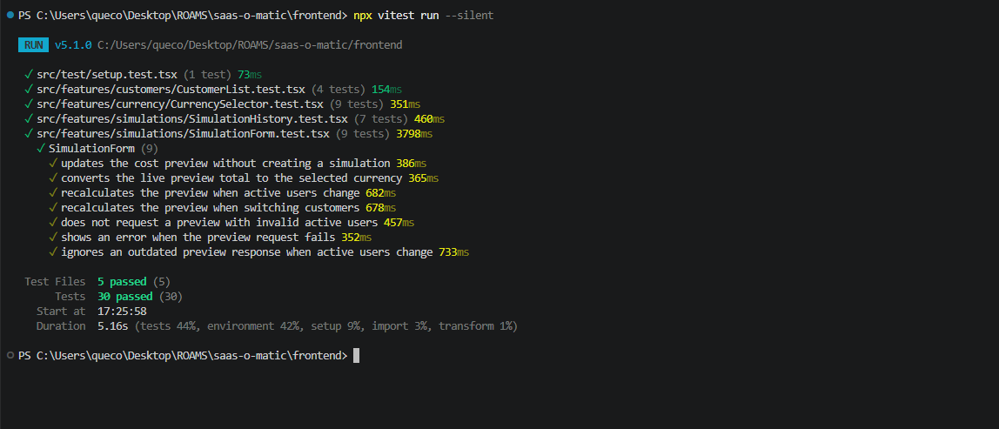

# Arquitectura de SaaS-O-Matic

## 1. Visión general

SaaS-O-Matic es una aplicación full-stack para la gestión de
clientes empresariales y la simulación de facturación mensual.

La arquitectura está dividida en tres componentes principales:

- **Frontend:** aplicación React desarrollada con TypeScript,
  Vite y Tailwind CSS.
- **Backend:** API REST desarrollada con Node.js, Express
  y TypeScript.
- **Base de datos:** SQLite, gestionada mediante Prisma ORM.

## 2. Arquitectura general

El frontend permite registrar clientes, consultar empresas,
realizar simulaciones y visualizar el historial de facturación.

Las operaciones se comunican con el backend mediante
peticiones HTTP que intercambian información en formato JSON.

El backend se encarga de:

- Validar los datos recibidos.
- Gestionar los clientes.
- Aplicar las reglas de facturación.
- Calcular impuestos según el país.
- Calcular la tarifa progresiva de usuarios y devolver el desglose de tramos para la vista previa.
- Guardar simulaciones y consultar su historial.
- Acceder a la base de datos mediante Prisma.

La base de datos SQLite almacena los clientes y sus
simulaciones, manteniendo la relación entre ambas entidades.

## 3. Comunicación entre componentes

Durante el desarrollo, React se ejecuta mediante Vite
en el puerto 5173 y Express en el puerto 3001.

Las peticiones del frontend utilizan el prefijo `/api`,
que Vite redirige al backend mediante un proxy.

Este diseño separa la presentación, la lógica de negocio
y la persistencia de datos.

### Endpoints principales

| Método y ruta                           | Uso                                                                 |
| --------------------------------------- | ------------------------------------------------------------------- |
| `GET /customers`, `POST /customers`     | Buscar y registrar clientes.                                        |
| `POST /simulations/preview`             | Calcular una vista previa sin persistirla.                          |
| `POST /simulations`, `GET /simulations` | Guardar simulaciones y consultar el historial paginado por cliente. |
| `GET /currency/rates`                   | Obtener las tasas y divisas disponibles.                            |
| `POST /currency/convert`                | Convertir un importe desde EUR.                                     |

En desarrollo, el frontend usa `/api` y Vite lo redirige a Express. El backend conserva las tasas en memoria durante una hora y puede reutilizar tasas anteriores si falla una actualización. EUR permanece como moneda base; la interfaz presenta las monedas que devuelve el endpoint.

### Flujo de creación de clientes

El siguiente diagrama representa el proceso de registro de clientes mediante el endpoint `POST /customers` del backend.

Cuando se recibe una petición, los datos se validan mediante Zod. Si la información proporcionada no cumple las reglas establecidas, la API devuelve una respuesta HTTP `400 Bad Request`.

Si los datos son válidos, el backend intenta crear el cliente en SQLite mediante Prisma ORM. La restricción de unicidad del identificador fiscal permite detectar registros duplicados, devolviendo `409 Conflict` cuando corresponde.

Si el registro se completa correctamente, la API devuelve `201 Created`.



_Figura. Flujo de creación de clientes, validación de datos y gestión de respuestas HTTP._

## 4. Diagrama de arquitectura general

El siguiente diagrama representa los componentes principales
del sistema y la comunicación entre ellos.



## 5. Modelo de datos: relación Customer–Simulation

SaaS-O-Matic utiliza dos entidades principales:

- **Customer:** representa una empresa registrada en el sistema.
- **Simulation:** representa una simulación de facturación
  realizada para un cliente.

La relación entre ambas entidades es de uno a muchos (1:N).

Un cliente puede tener cero o múltiples simulaciones,
mientras que cada simulación pertenece a un único cliente.

### Diagrama entidad-relación



El campo `customerId` de `Simulation` identifica al
cliente al que pertenece cada simulación.

Esta relación permite consultar el historial de
simulaciones de una empresa y conservar múltiples
resultados de facturación asociados a un mismo cliente.

El diagrama muestra los campos representativos de la
relación; no pretende enumerar todas las columnas
del esquema de Prisma.

## 6. Persistencia e integridad histórica

El modelo de datos está diseñado para conservar los resultados
de cada simulación de facturación.

Cada simulación almacena los datos utilizados en el cálculo:

- `activeUsers`: número de usuarios activos.
- `storageGb`: almacenamiento utilizado en GB.
- `apiCalls`: número de llamadas a la API.
- `planSnapshot`: plan del cliente al realizar la simulación.
- `countrySnapshot`: país del cliente al realizar la simulación.
- `taxRateSnapshot`: tipo impositivo aplicado.
- `usersCostCents`: coste calculado por usuarios.
- `subtotalCents`: importe antes de impuestos.
- `taxCents`: impuestos calculados.
- `totalCents`: importe final.

### Conservación de datos históricos

Los campos terminados en `Snapshot` permiten conservar
información del momento en que se realizó la simulación.

De esta manera, si posteriormente cambia el plan o el país
del cliente, las simulaciones anteriores mantienen sus
valores históricos.

### Precisión monetaria

Los importes se almacenan como números enteros que representan
céntimos de euro.

Esto evita almacenar cantidades monetarias mediante números
de coma flotante y facilita la comparación de resultados
y la realización de pruebas automatizadas.

### Integridad de los clientes

Cada cliente tiene un identificador único.

Además, Prisma define una restricción de unicidad compuesta
sobre `country` y `taxId`, que evita duplicar el mismo
identificador fiscal dentro de un país.

## 7. Motor de facturación

SaaS-O-Matic calcula la facturación mensual mediante un
sistema de tarifas progresivas por número de usuarios activos.

### Tarifas por usuarios

| Tramo de usuarios       | Precio por usuario |
| ----------------------- | ------------------ |
| Usuarios 1-10           | 10 €               |
| Usuarios 11-50          | 8 €                |
| Usuarios 51 en adelante | 5 €                |

El cálculo es progresivo: cada tarifa se aplica únicamente
a los usuarios incluidos en su tramo correspondiente.

Por ejemplo, para 60 usuarios activos:

- Primeros 10 usuarios: 10 × 10 € = 100 €.
- Siguientes 40 usuarios: 40 × 8 € = 320 €.
- Últimos 10 usuarios: 10 × 5 € = 50 €.

Subtotal: 470 €.

### Impuestos por país

| País          | Impuesto |
| ------------- | -------- |
| España (ES)   | 21 %     |
| Francia (FR)  | 20 %     |
| Alemania (DE) | 19 %     |

El impuesto se aplica al coste progresivo de usuarios. Los planes,
el almacenamiento y las llamadas a la API no añaden costes.

### Otros parámetros

El sistema permite introducir el almacenamiento utilizado
(`storageGb`) y las llamadas a la API (`apiCalls`).

Estos valores se conservan en la simulación, pero actualmente
no generan costes adicionales, conforme a las aclaraciones
de los requisitos de la prueba técnica.

El plan del cliente también se conserva como información
histórica, sin modificar la tarifa por usuarios.

### Vista previa y persistencia

El frontend ofrece una vista previa del cálculo que se
actualiza al modificar los parámetros de la simulación.

Esta vista previa utiliza el backend para obtener los importes,
pero no guarda ninguna simulación en la base de datos.

La simulación únicamente se almacena cuando el usuario
confirma expresamente su creación.

De esta manera, tanto la vista previa como las simulaciones
guardadas utilizan las mismas reglas de facturación.

### Evidencia visual de la vista previa

La siguiente captura muestra una simulación de facturación
para un cliente de Francia con 60 usuarios activos,
100 GB de almacenamiento y 1000 llamadas a la API.

El sistema calcula un subtotal de 470,00 €, aplica
un impuesto del 20 % y obtiene un total mensual
de 564,00 €.

La vista previa no genera registros en la base de datos
hasta que el usuario confirma la creación de la simulación.



## 8. Pruebas automatizadas

SaaS-O-Matic incluye pruebas automatizadas tanto en el
backend como en el frontend.

### Backend

El backend utiliza Vitest y Supertest para comprobar
la lógica de negocio y el comportamiento de la API.

Las pruebas cubren, entre otras funcionalidades:

- Validación de datos de entrada.
- Registro y consulta de clientes.
- Detección de clientes duplicados.
- Cálculo progresivo de costes por usuarios.
- Aplicación de impuestos según el país.
- Creación y consulta de simulaciones.
- Vista previa de facturación sin persistencia.
- Gestión de errores y respuestas HTTP.

Para ejecutar las pruebas:

```bash
cd backend
npm test
```

### Frontend

El frontend utiliza Vitest y React Testing Library
para comprobar el comportamiento de los componentes.

Las pruebas cubren, entre otras funcionalidades:

- Actualización de la vista previa de facturación.
- Sincronización del control deslizante de usuarios.
- Cambio de cliente y recálculo de impuestos.
- Validación de parámetros.
- Gestión de errores de la API.
- Reintento de carga de clientes.
- Acceso directo al historial de un cliente.
- Paginación del historial.
- Protección frente a respuestas asíncronas antiguas.

Para ejecutar las pruebas:

```bash
cd frontend
npm test
```

### Comprobación de compilación

También se puede verificar la compilación de ambos proyectos:

```bash
cd backend
npm run build
```

```bash
cd frontend
npm run build
```

Estas comprobaciones permiten detectar errores de TypeScript
y problemas de construcción antes de entregar el proyecto.

Desde la raíz del repositorio, `npm run verify` ejecuta las suites de pruebas, el lint, los chequeos de tipos y los builds de ambos proyectos. Los resultados de la última ejecución se registran en [la revisión de calidad](../ai-workspace/05-quality-review.md).

### Evidencias de ejecución

Las siguientes capturas muestran los resultados de las pruebas automatizadas ejecutadas el **18 de noviembre de 2026**, correspondientes a la versión actual del proyecto en el momento de su verificación.

- **Backend:** 450 pruebas superadas en 18 archivos.
- **Frontend:** 30 pruebas superadas en 5 archivos.

Los detalles de las verificaciones adicionales, incluidas las comprobaciones de compilación, tipos y calidad del código, se encuentran documentados en [la revisión de calidad](../ai-workspace/05-quality-review.md).

#### Capturas de las pruebas automatizadas





## 9. Diagramas disponibles como imágenes

Los diagramas de arquitectura y modelo de datos también
están disponibles como archivos PNG para su consulta
o incorporación a otros documentos.

- [Diagrama de arquitectura general](evidence/architecture-diagram.png)
- [Diagrama Customer–Simulation](evidence/customer-simulation-diagram.png)
- [Diagrama del flujo de creación de clientes](evidence/customer-creation-flow.png)
