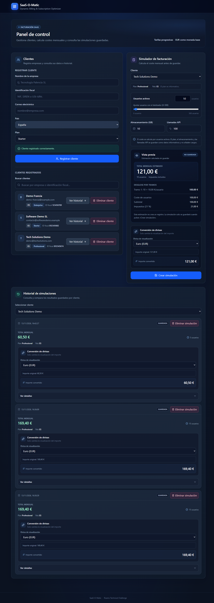
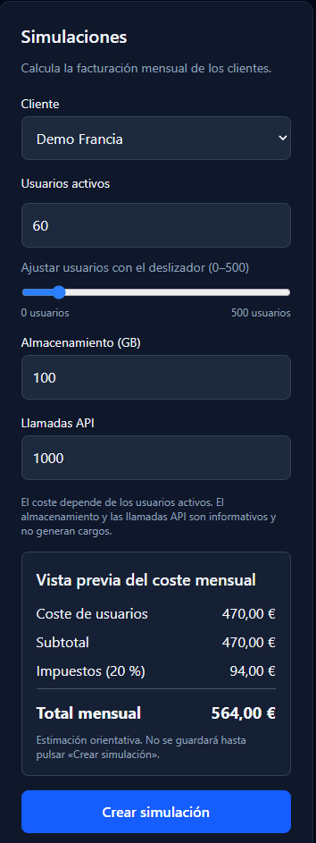

# Guía de uso de SaaS-O-Matic

Esta guía describe las funciones disponibles en la aplicación y un recorrido para registrar una empresa y guardar una simulación. Los identificadores de ejemplo son ficticios y sirven para ilustrar las reglas técnicas del formulario; no certifican que una empresa exista ni que el identificador esté activo ante una autoridad fiscal.

## Índice

- [Abrir el dashboard](#abrir-el-dashboard)
- [Registrar un cliente](#registrar-un-cliente)
- [Validaciones y ejemplos](#validaciones-y-ejemplos)
- [Mensajes de validación](#mensajes-de-validación)
- [Buscar clientes y consultar su historial](#buscar-clientes-y-consultar-su-historial)
- [Crear una simulación](#crear-una-simulación)
- [Vista previa y guardado](#vista-previa-y-guardado)
- [Consultar el historial](#consultar-el-historial)
- [Conversión de divisas](#conversión-de-divisas)
- [Eliminar datos](#eliminar-datos)
- [Recorrido completo de ejemplo](#recorrido-completo-de-ejemplo)

## Abrir el dashboard

Inicia la aplicación siguiendo la [guía de instalación](installation-guide.md) y abre [http://localhost:5173](http://localhost:5173). El dashboard agrupa estas secciones: **Panel de control**, **Clientes**, **Simulador de facturación** e **Historial de simulaciones**.

## Registrar un cliente

En **Clientes → Registrar cliente**, completa los campos:

| Campo | Reglas vigentes |
| --- | --- |
| Nombre de la empresa | Obligatorio; entre 1 y 150 caracteres después de quitar espacios exteriores. |
| Identificación fiscal | Obligatoria; debe ajustarse al formato asociado al país seleccionado. |
| Correo electrónico | Obligatorio; formato de email y máximo 254 caracteres. Se eliminan espacios exteriores y se convierte a minúsculas. |
| País | Obligatorio: España (`ES`), Francia (`FR`) o Alemania (`DE`). |
| Plan | Obligatorio: `Starter`, `Professional` o `Enterprise`. El plan es informativo y no afecta al precio de la simulación. |

Al guardar, también se recortan espacios exteriores del nombre y del identificador; este último se convierte a mayúsculas. Los separadores dentro de un identificador se conservan y normalmente hacen que no pase el formato. Un identificador no puede repetirse para el mismo país. La aplicación no consulta registros fiscales oficiales.

## Validaciones y ejemplos

El frontend marca los campos inválidos y el backend vuelve a validar los datos antes de guardarlos. La selección del país determina el validador fiscal.

### España: DNI, NIE y NIF de entidades

- **DNI:** ocho dígitos y una letra de control, calculada mediante el resto de dividir el número entre 23.
- **NIE:** `X`, `Y` o `Z`, siete dígitos y una letra de control calculada con la equivalencia `X=0`, `Y=1`, `Z=2` y la misma tabla de control del DNI.
- **NIF de entidad:** una letra de prefijo admitida, siete dígitos y un control numérico o alfabético según el prefijo. El cálculo suma dígitos con duplicación alterna.

| Ejemplo | Resultado del validador | Motivo |
| --- | --- | --- |
| `12345678Z` | Aceptado | DNI con letra de control coincidente. |
| `12345678A` | Rechazado | Letra de control incorrecta. |
| `X0000000T` | Aceptado | NIE con formato y control correctos. |
| `B12345674` | Aceptado | NIF de entidad con control numérico coincidente. |
| `B1234567D` | Rechazado | Prefijo `B` requiere control numérico y el control no coincide. |

### Francia: SIREN

El campo admite exactamente nueve dígitos. El código no comprueba el dígito de control SIREN ni consulta el registro oficial. Por eso `123456789` pasa la validación de formato de la aplicación, aunque no debe interpretarse como verificación de un SIREN real.

| Ejemplo | Resultado del validador | Motivo |
| --- | --- | --- |
| `123456789` | Aceptado por formato | Nueve dígitos; sin comprobación de control. |
| `12345678` | Rechazado | Tiene ocho dígitos. |
| `FR123456789` | Rechazado | El prefijo `FR` no forma parte del SIREN solicitado. |
| `123 456 789` | Rechazado | Contiene separadores internos. |

### Alemania: USt-IdNr. con formato `DE`

El código admite las letras `DE` seguidas de nueve dígitos. No calcula un dígito de control ni valida el identificador ante una autoridad alemana.

| Ejemplo | Resultado del validador | Motivo |
| --- | --- | --- |
| `DE123456789` | Aceptado por formato | Prefijo `DE` y nueve dígitos. |
| `DE12345678` | Rechazado | Solo tiene ocho dígitos después del prefijo. |
| `DE1234567890` | Rechazado | Tiene diez dígitos después del prefijo. |
| `DE123 456789` | Rechazado | Contiene un espacio interno. |

### Nombre, correo y campos obligatorios

| Entrada | Resultado | Regla |
| --- | --- | --- |
| `  Tecnología Palencia SL  ` | Aceptada como `Tecnología Palencia SL` | Se recortan espacios exteriores; máximo 150 caracteres. |
| Campo de nombre vacío o solo espacios | Rechazada | El nombre debe tener al menos un carácter tras recortarlo. |
| Nombre de 151 caracteres | Rechazado | Supera el máximo de 150. |
| `  CONTACTO@EMPRESA.COM ` | Aceptado como `contacto@empresa.com` | Email válido; se recorta y pasa a minúsculas. |
| `nombre@empresa.com` | Aceptado | Formato de email. |
| `correo-invalido` o `contacto@` | Rechazado | No tiene un formato de email aceptado. |
| País `IT` o plan `Premium` | Rechazados | No están entre las opciones disponibles. |

El formulario marca nombre, identificador, correo, país y plan como obligatorios. Para identificadores fiscales también se recortan los extremos y se convierten las letras a mayúsculas. Por ejemplo, ` 12345678z ` se guarda normalizado como `12345678Z`; un espacio interno como `1234 5678Z` no se elimina y el DNI se rechaza.

## Mensajes de validación

Algunos errores se muestran junto al campo y otros en una alerta del formulario:

| Situación | Mensaje visible |
| --- | --- |
| Datos de formulario incorrectos | `Revisa los campos indicados.` |
| Identificador fiscal español incorrecto | `La identificación fiscal no es válida para España. Comprueba el formato y los caracteres de control.` |
| Identificador francés incorrecto | `La identificación fiscal no es válida para Francia. Comprueba que tenga 9 dígitos.` |
| Identificador alemán incorrecto | `La identificación fiscal no es válida para Alemania. Comprueba que tenga el formato DE seguido de 9 dígitos.` |
| Correo inválido | `Introduce una dirección de correo electrónico válida.` |
| Nombre incorrecto | `Comprueba el nombre de la empresa.` |
| Cliente duplicado en el país | `Ya existe un cliente con esa identificación fiscal en el país seleccionado.` |
| No se puede conectar con la API | `No se pudo conectar con el servidor. Comprueba que la aplicación esté en marcha e inténtalo de nuevo.` |

Los campos requeridos también tienen validación del navegador. Cuando una respuesta del backend no identifica un campo conocido, se muestra: `No se pudo registrar el cliente. Inténtalo de nuevo más tarde.`

## Buscar clientes y consultar su historial

En **Clientes registrados**, escribe en **Buscar clientes**. La búsqueda encuentra coincidencias parciales por nombre de empresa o identificador fiscal; la comparación del identificador ignora mayúsculas/minúsculas. Si no hay coincidencias, prueba con otro fragmento. Pulsa **Ver historial** en la ficha del cliente para seleccionarlo en **Historial de simulaciones** y desplazarte a esa sección.

## Crear una simulación

En **Simulador de facturación**:

1. Selecciona un cliente registrado.
2. Indica los usuarios activos (entero de 0 a 100 000). Puedes usar el campo numérico o el deslizador, que cubre de 0 a 500.
3. Indica almacenamiento en GB (entero de 0 a 1 000 000) y llamadas a la API (entero de 0 a 100 000 000).
4. Revisa la vista previa y pulsa **Crear simulación** para guardarla.

El coste depende solo del número de usuarios, con tramos progresivos acumulativos:

| Usuarios | Precio unitario |
| --- | ---: |
| Primeros 10 | 10 € por usuario |
| Del 11 al 50 | 8 € por usuario |
| Desde el 51 | 5 € por usuario |

Ejemplo para 15 usuarios: `10 × 10 € + 5 × 8 € = 140 €` de subtotal. El impuesto simplificado depende del país guardado en el cliente: España 21 %, Francia 20 % y Alemania 19 %. Para un cliente español, el impuesto es 29,40 € y el total estimado 169,40 €. Estas tasas son reglas simplificadas de la prueba técnica, no asesoramiento ni cálculo fiscal oficial. El plan, el almacenamiento y las llamadas API se registran como datos informativos y no añaden coste.

## Vista previa y guardado

La sección **Vista previa** calcula y muestra el total mensual, los tramos, el subtotal y el impuesto sin crear un registro. La vista previa se actualiza al cambiar los datos válidos y se marca **No guardada**. Solo **Crear simulación** envía el guardado al backend. Tras guardarla, aparece el resultado y la simulación se añade al historial.

## Consultar el historial

En **Historial de simulaciones**, selecciona un cliente. Las entradas se muestran de más reciente a más antigua, en grupos de hasta 10; pulsa **Mostrar más** para cargar el siguiente grupo. Cada entrada presenta total mensual, usuarios, plan y país guardados. Abre **Ver detalles** para consultar almacenamiento, llamadas a la API, coste de usuarios, subtotal, impuesto y total. La aplicación conserva en cada simulación los datos del cliente y las tasas usados en el cálculo.

## Conversión de divisas

La moneda base de cálculo y almacenamiento es EUR. En **Conversión de divisas**, selecciona otra moneda para mostrar el total convertido; esto no cambia ni reescribe el importe original. Las opciones disponibles llegan desde una API externa de tipos de cambio con EUR como base. El backend mantiene una caché en memoria durante una hora y, si la consulta externa falla, puede reutilizar una tasa previa indicando que está desactualizada. Si no tiene tasas, la conversión no está disponible; se mantiene visible el importe original en euros. Los tipos pueden cambiar y no son valores fijos.

## Eliminar datos

En una ficha de **Clientes registrados**, pulsa **Eliminar cliente** y confirma el diálogo del navegador. La operación elimina el cliente y todas sus simulaciones asociadas; no se puede deshacer. Si cancelas el diálogo, no se elimina nada.

En una entrada del historial, pulsa **Eliminar simulación** y confirma. Se elimina únicamente esa simulación; el cliente y las demás simulaciones permanecen. Si la operación falla, la interfaz muestra un error y conserva el registro en la lista.

## Recorrido completo de ejemplo

1. Inicia SaaS-O-Matic y abre `http://localhost:5173`.
2. En **Registrar cliente**, introduce `Empresa Demo SL`, `12345678Z`, `demo@example.com`, país **España** y plan **Professional**; pulsa **Registrar cliente**.
3. Comprueba que aparece en **Clientes registrados**. Búscala escribiendo `Empresa Demo` o `12345678Z`.
4. En **Simulador de facturación**, elige **Empresa Demo SL**.
5. Deja 15 usuarios y escribe `100` GB y `5000` llamadas a la API.
6. Revisa la vista previa: subtotal 140,00 €, impuesto 29,40 € y total 169,40 €.
7. Pulsa **Crear simulación**.
8. Pulsa **Ver historial** en la ficha o elige el mismo cliente en **Historial de simulaciones**.
9. En la entrada recién creada, abre **Ver detalles** y prueba otra divisa si hay tasas disponibles.
10. Para comprobar la eliminación, usa un registro de prueba: elimina primero la simulación individual, o elimina el cliente de demostración para borrar también cualquier simulación suya.

---

La carpeta [`docs/evidence/`](evidence/) contiene capturas del dashboard y de la vista previa, además de diagramas técnicos. No hay capturas de la versión actual que muestren errores de validación, historial o diálogos de eliminación; esas vistas se describen aquí sin presentarlas como evidencia visual.
